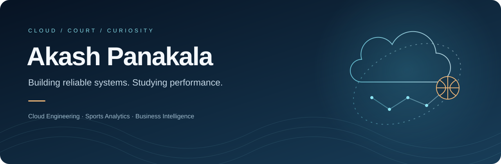

  <strong>Cloud & DevOps Engineer · Basketball Analytics · Doctoral Student</strong>

  <a href="#engineering">Engineering</a> &nbsp; / &nbsp;
  <a href="#research">Research</a> &nbsp; / &nbsp;
  <a href="#toolkit">Toolkit</a> &nbsp; / &nbsp;
  <a href="#education">Education</a> &nbsp; / &nbsp;
  <a href="#beyond-the-terminal">Beyond the terminal</a>

---

## One person. Three connected perspectives.

I’m **Akash Panakala**. I build cloud infrastructure and delivery pipelines, study business intelligence, and explore basketball through data.

Engineering taught me to investigate failures. Basketball taught me to look beyond the scoreboard. Research gives me a way to test both instincts.

**The question connecting my work: what can we measure, trust, and improve?**

<table>
<tr>
<td width="33%" valign="top">

### Build
**Cloud engineering**

Infrastructure, automation, and delivery systems that make applications easier to operate.

</td>
<td width="33%" valign="top">

### Investigate
**Sports analytics**

Player-performance modeling with explicit baselines, chronological evaluation, and error analysis.

</td>
<td width="33%" valign="top">

### Decide
**Business intelligence**

Turning technical findings into information people can use to make better decisions.

</td>
</tr>
</table>

## Engineering

My experience includes cloud infrastructure, CI/CD, containerized applications, and monitoring across AWS and Azure environments.

| Engineering problem | My experience |
| :--- | :--- |
| Make deployments repeatable | Building delivery pipelines with Jenkins, GitHub Actions, and Azure DevOps |
| Keep infrastructure consistent | Defining and managing resources with Terraform and CloudFormation |
| Operate containerized applications | Working with Docker, Kubernetes, and OpenShift |
| Understand production behavior | Using metrics and logs through Prometheus, Grafana, ELK, and Splunk |
| Bring checks into delivery | Integrating code-quality and vulnerability-scanning tools into pipelines |

<strong>A closer look at my engineering background</strong>

 

**Application delivery:** Experience supporting React/Next.js and Nest.js application delivery, with container workflows and CI/CD automation.

**AWS systems:** Work involving EC2, S3, ECS, IAM, VPC networking, and messaging services, alongside infrastructure as code.

**Operations:** Linux administration, reverse proxies, deployment troubleshooting, and observability.

**Automation:** Python, Bash, and PowerShell for repeatable operational tasks.

I value a deployment process the next engineer can understand, monitoring that helps explain failures, and infrastructure changes that can be reviewed.

## Research

### NBA player-performance analytics
**Ongoing project · Predictive modeling · Basketball**

A recent scoring average is an intuitive forecast. My research asks whether additional context and more complex models improve on that baseline—and where they still fail.

| Question | Approach |
| :--- | :--- |
| What does a simple forecast already explain? | Establish a last-five-games scoring baseline |
| Do additional features improve predictions? | Explore recent performance, playing time, and rest |
| Does model complexity help? | Compare linear regression with tree-based models |
| Would the evaluation reflect future prediction? | Use chronological splits and time-based cross-validation |
| Which players are harder to predict? | Examine errors by player and scoring group |

**What I want the work to demonstrate:** a clear chain from the question and data preparation to evaluation, interpretation, and limitations.

<strong>Research principles & next milestones</strong>

 

- **Respect time.** Features should use information available before the game being predicted.
- **Earn complexity.** Compare every model with an understandable baseline.
- **Inspect the misses.** A good average error can hide uneven performance across players.
- **Separate prediction from explanation.** A predictive relationship does not establish causation.
- **Make results reproducible.** Document data sources, transformations, splits, and evaluation choices.

Next milestones include deeper per-player error analysis, organizing a reproducible project release, and developing the research write-up.

## Toolkit

<strong>Cloud, infrastructure & delivery</strong>

 

| Area | Technologies |
| :--- | :--- |
| Cloud platforms | AWS · Azure |
| Infrastructure as code | Terraform · CloudFormation |
| Configuration | Ansible |
| CI/CD | Jenkins · GitHub Actions · GitLab CI · Azure DevOps |
| Containers | Docker · Kubernetes · OpenShift |
| GitOps | Argo CD · Flux |

<strong>Programming, observability & security tooling</strong>

 

| Area | Technologies |
| :--- | :--- |
| Programming & scripting | Python · Bash · PowerShell · Groovy |
| Monitoring & logging | Prometheus · Grafana · ELK · Splunk · Datadog |
| Quality & security checks | SonarQube · Trivy · OWASP tools · Snyk |
| Data & messaging | MongoDB Atlas · Redis · Kafka |
| Systems | Linux · Nginx |

## Education

| Study | Institution / focus |
| :--- | :--- |
| Doctoral studies — in progress | Belhaven University · Business Intelligence |
| Master’s in Computer Science | Wichita State University |
| Bachelor’s in Information Technology | India |

My academic direction connects quantitative analysis, technology, and business decision-making.

## Beyond the terminal

**I played the game before I started modeling it.**

Basketball is the starting point of my interest in sports analytics. Competing made me curious about performance, consistency, and the context behind a result.

| Background | Highlights |
| :--- | :--- |
| Basketball | U-19 nationals participation · U-19 state silver · Senior state gold and bronze |
| Softball | Three gold medals |
| Other experience | Volleyball · NCC cadet |

The athlete in me asks what happened on the court. The researcher asks what the evidence supports. The engineer asks how to build something useful from it.

---

### Let’s connect through the work

I’m interested in **cloud and DevOps engineering**, **basketball analytics**, and **research collaborations** that connect data with practical decisions.

[Explore my repositories](https://github.com/Akashpanakala?tab=repositories)

  Build with discipline. Measure with curiosity.

